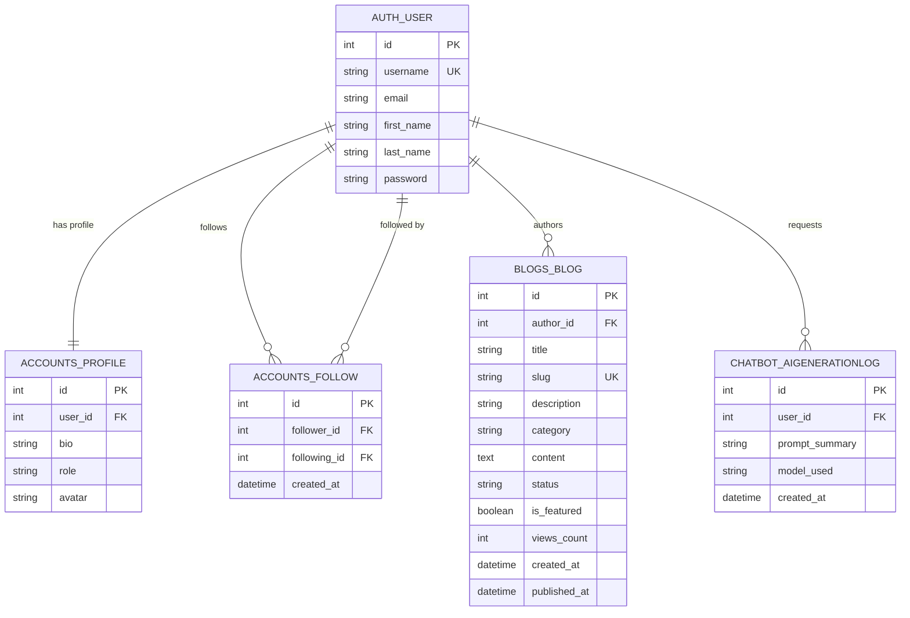
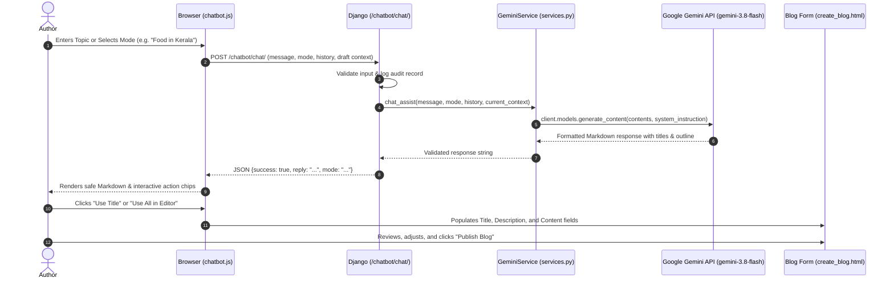

# INKSPACE – Django MVT Blogging Platform with Google Gemini AI

## 1. Project Introduction & Purpose

**INKSPACE** is a full-featured, responsive, editorial blogging platform inspired by publications like Medium, built using Python Django and the Model-View-Template (MVT) architecture. 

The application is engineered as a comprehensive learning platform demonstrating how real-world Django applications are architected: clean modular separation, URL routing, relational SQLite database models, form validation, user authentication, role-based authorization, and modern generative AI integration.

INKSPACE incorporates an **AI Writing Assistant** powered by the **Google Gemini API** (`google-genai` Python SDK). Writers can prompt Gemini to generate publication-ready blog titles, concise preview summaries, and full structured articles, with one-click insertion directly into the blog editor.

---

## 2. Main Objectives

1. **Master Django MVT Architecture**: Understand the distinct responsibilities of Models (database), Views (logic & flow control), and Templates (HTML presentation).
2. **Implement Secure CRUD Operations**: Enable authenticated authors to create, read, edit, delete, draft, and publish stories with strict ownership validation.
3. **Real-world Authentication & Authorization**: Provide registration, login, logout, session management ("Remember me"), and user profile management.
4. **Google Gemini Generative AI Integration**: Connect Django backend services to the Gemini API (`gemini-3.8-flash`) to generate structured blog content.
5. **Modern Editorial UI Design**: Build a clean, responsive layout using Bootstrap 5 and custom CSS following an editorial color palette (`#C65D24` primary orange, `#E87932` secondary orange, `#F59E0B` accent orange, `#FFF7ED` warm cream paper background, `#FFEDD5` light orange, `#9A3412` hover orange).

---

## 3. Phase 1 Conversion Analysis & Feature Mapping

### Transformation from TypeScript React to Django MVT
The original prototype received from Google AI Studio was built as a single-page React application using TypeScript, in-memory mock data arrays, client-side state hooks (`useState`), and direct client-side Gemini calls. 

To satisfy the primary goal of mastering production-grade Django MVT development, the application has been completely re-engineered into pure Python Django with server-rendered HTML templates, SQLite persistence, and vanilla JavaScript.

### Architectural Mapping Table

| Old TypeScript Component / File | New Django MVT Component | Pattern / Role |
|---|---|---|
| `src/pages/HomePage.tsx` | `apps/blogs/views.py::blog_list()` + `templates/blogs/blog_list.html` | MVT View & Template: Queries SQLite for published stories, isolates featured hero card, and renders 3-column story grid. |
| `src/pages/ExplorePage.tsx` | `apps/blogs/views.py::explore_blogs()` + `templates/blogs/explore.html` | MVT View & Template: Category filtering & live search using Django `Q` objects. |
| `src/pages/BlogDetailPage.tsx` | `apps/blogs/views.py::blog_detail()` + `templates/blogs/blog_detail.html` | MVT View & Template: Fetches story by slug, increments views atomically via `F()`, author sidebar, and follow toggle. |
| `src/pages/CreateBlogPage.tsx` | `apps/blogs/views.py::create_blog()` + `templates/blogs/create_blog.html` | MVT Form & View: `BlogForm` ModelForm, image upload, toolbar formatting, and Gemini AI modal integration. |
| `src/pages/EditBlogPage.tsx` | `apps/blogs/views.py::edit_blog()` + `templates/blogs/edit_blog.html` | MVT View: Owner-only authorization check (`blog.author == request.user`), form pre-population, and updates. |
| `src/pages/MyBlogsPage.tsx` | `apps/blogs/views.py::my_blogs()` + `templates/blogs/my_blogs.html` | MVT Dashboard: Filters user's posts, computes All/Published/Draft tab counts, and provides card/table views. |
| `src/pages/LoginPage.tsx` | `apps/accounts/views.py::login_view()` + `templates/accounts/login.html` | MVT Auth: `LoginForm` supporting email/username resolution, Django `authenticate()`, and "Remember me" session expiry. |
| `src/pages/SignupPage.tsx` | `apps/accounts/views.py::signup_view()` + `templates/accounts/signup.html` | MVT Auth: `SignUpForm` with name splitting, password validation, and auto-login after creation. |
| `src/pages/ProfilePage.tsx` | `apps/accounts/views.py::profile_view()` + `templates/accounts/profile.html` | MVT Profile: `ProfileForm` managing bio, role, and avatar. |
| `src/pages/AboutPage.tsx` | `apps/blogs/views.py::about_view()` + `templates/blogs/about.html` | Static MVT View: Editorial vision and feature breakdown. |
| `src/pages/ContactPage.tsx` | `apps/blogs/views.py::contact_view()` + `templates/blogs/contact.html` | MVT Form & View: `ContactForm` validation and alert messages. |
| `src/pages/PrivacyPage.tsx` | `apps/blogs/views.py::privacy_view()` + `templates/blogs/privacy.html` | Static MVT View: Data ethics, privacy, and copyright policy. |
| `src/components/Navbar.tsx` | `templates/includes/navbar.html` | Reusable Template Include: Dynamic user session state, dropdown menu, and active page pills. |
| `src/components/Footer.tsx` | `templates/includes/footer.html` | Reusable Template Include: Platform links and author social profiles. |
| `src/components/ChatbotWidget.tsx` | `apps/chatbot/templates/chatbot/chatbot_widget.html` + `static/chatbot/js/chatbot.js` | Floating widget UI with vanilla JS fetch to `/chatbot/chat/` and quick prompt pills. |
| `src/components/AIModal.tsx` | `templates/blogs/create_blog.html` (modal section) + `static/chatbot/js/chatbot.js` | Topic-to-blog generator modal with direct insertion into editor form fields. |
| `src/services/gemini.ts` | `apps/chatbot/services.py` (`GeminiService`) | Python service using official `google-genai` SDK with fallback generator. |
| `src/data/initialData.ts` | `seed_db.py` | SQLite database seeder with PBKDF2 password hashing for immediate login. |

---

## 4. Technology Stack

### Backend
- **Language**: Python 3.10+
- **Framework**: Django 5.x
- **Architecture**: Model-View-Template (MVT)
- **Database**: SQLite 3 (relational engine)
- **Environment Management**: `python-dotenv`
- **Image Handling**: Pillow

### Frontend
- **Markup**: HTML5 with Django Template Language (DTL)
- **Styling**: Bootstrap 5.3.3 + Custom CSS (`static/css/style.css`)
- **Typography**: Google Fonts (Lora for serif editorial headlines, Plus Jakarta Sans for body text)
- **Icons**: Bootstrap Icons (v1.11.3)
- **Interactivity**: Vanilla JavaScript (ES6+)

### AI Integration
- **Engine**: Google Gemini API (`gemini-3.8-flash`)
- **SDK**: Official Google Gen AI Python SDK (`google-genai`)
- **Service Layer**: Dedicated `GeminiService` class inside `apps/chatbot/services.py`

---

## 4. Complete Project Folder Structure

```
INKSPACE/
│
├── config/                         # Core Django configuration package
│   ├── __init__.py
│   ├── settings.py                 # Application settings, installed apps, Gemini config
│   ├── urls.py                     # Root URL routing
│   ├── asgi.py                     # ASGI server entrypoint
│   └── wsgi.py                     # WSGI server entrypoint
│
├── apps/                           # Modular Django applications
│   ├── __init__.py
│   │
│   ├── accounts/                   # User authentication & profile management
│   │   ├── migrations/             # Database migrations
│   │   │   ├── __init__.py
│   │   │   └── 0001_initial.py
│   │   ├── templates/accounts/
│   │   │   ├── login.html          # Split-screen login view
│   │   │   ├── signup.html         # Split-screen registration view
│   │   │   └── profile.html        # Profile management view
│   │   ├── static/accounts/css/
│   │   ├── __init__.py
│   │   ├── admin.py                # User and Profile admin configuration
│   │   ├── apps.py                 # Accounts app config
│   │   ├── forms.py                # SignUpForm, LoginForm, ProfileForm
│   │   ├── models.py               # Profile model with User signal
│   │   ├── urls.py                 # Account routes (/accounts/login/, etc.)
│   │   ├── views.py                # signup_view, login_view, logout_view
│   │   └── tests.py                # Authentication unit tests
│   │
│   ├── blogs/                      # Core blogging platform & CRUD logic
│   │   ├── migrations/
│   │   │   ├── __init__.py
│   │   │   └── 0001_initial.py
│   │   ├── templates/blogs/
│   │   │   ├── blog_list.html      # Editorial homepage (Hero + Featured + Latest)
│   │   │   ├── blog_detail.html    # Article reader + author sidebar with Follow toggle
│   │   │   ├── create_blog.html    # Story editor + AI assistant modal
│   │   │   ├── edit_blog.html      # Edit story form
│   │   │   ├── explore.html        # Search & category browse
│   │   │   ├── my_blogs.html       # Responsive author dashboard with Card/Table toggle
│   │   │   ├── about.html          # About INKSPACE editorial mission
│   │   │   ├── contact.html        # Contact form with validation & social links
│   │   │   └── privacy.html        # Privacy policy & data protection terms
│   │   ├── static/blogs/css/
│   │   ├── __init__.py
│   │   ├── admin.py                # Blog model admin registration
│   │   ├── apps.py                 # Blogs app config
│   │   ├── forms.py                # BlogForm & ContactForm
│   │   ├── models.py               # Blog model with slug & reading time
│   │   ├── urls.py                 # Blog routes (/create/, /about/, /contact/, /privacy/, etc.)
│   │   ├── views.py                # blog_list, create_blog, about_view, contact_view, privacy_view
│   │   └── tests.py                # CRUD & permission tests
│   │
│   └── chatbot/                    # AI Writing Assistant (Google Gemini Backend)
│       ├── migrations/
│       │   ├── __init__.py
│       │   └── 0001_initial.py
│       ├── templates/chatbot/
│       │   └── chatbot_widget.html # Floating AI assistant widget
│       ├── static/chatbot/
│       │   ├── css/chatbot.css     # Chatbot styles & animations
│       │   └── js/chatbot.js       # Chatbot frontend client & DOM binding
│       ├── __init__.py
│       ├── admin.py                # AIGenerationLog admin
│       ├── apps.py                 # Chatbot app config
│       ├── models.py               # AIGenerationLog audit model
│       ├── urls.py                 # JSON endpoints (/chatbot/generate-blog/)
│       ├── views.py                # generate_blog_api, chat_message_api
│       ├── services.py             # Official google-genai SDK wrapper
│       └── tests.py                # Chatbot API validation tests
│
├── templates/                      # Global template directory
│   ├── base.html                   # Master layout with navbar, footer, widget
│   ├── includes/
│   │   ├── navbar.html             # Brand navbar with search & mobile menu
│   │   ├── footer.html             # Editorial footer with social links
│   │   └── messages.html           # Django alert messages
│   └── errors/
│       ├── 403.html                # Forbidden permission error page
│       ├── 404.html                # Page not found error page
│       └── 500.html                # Server error page
│
├── static/                         # Static assets
│   ├── css/style.css               # Global brand styling
│   ├── js/main.js                  # General UI scripts
│   └── images/
│
├── media/                          # User-uploaded files
│   └── blog_covers/                # Uploaded blog hero images
│
├── db.sqlite3                      # Relational SQLite database
├── manage.py                       # Django CLI tool
├── requirements.txt                # Python package dependencies
├── .env.example                    # Template for environment variables
├── .gitignore
├── PROJECT_OVERVIEW.md             # Project architecture overview
└── LEARNING_GUIDE.md               # Detailed Django MVT learning document
```

---

## 5. Database Models and Relationships



### Blog Model Specifications
- **`author`**: `models.ForeignKey(User, on_delete=models.CASCADE, related_name='blogs')`
- **`title`**: `models.CharField(max_length=255)`
- **`slug`**: `models.SlugField(max_length=300, unique=True, blank=True)` – auto-generated via `slugify()` with collision avoidance.
- **`description`**: `models.CharField(max_length=250)` – short summary for cards and search results.
- **`category`**: Choices: `Travel`, `Technology`, `Lifestyle`, `Food`, `Education`, `Health`.
- **`content`**: `models.TextField()` – HTML/Markdown article body.
- **`status`**: Choices: `Draft`, `Published`.
- **`views_count`**: Incremented safely via atomic `F('views_count') + 1`.
- **`reading_time`**: Dynamic property estimating word count at 200 words per minute.

---

## 6. Gemini AI Writing Assistant Architecture

The AI Writing Assistant operates as an intelligent blog-writing mentor powered by the official Google Gen AI Python SDK (`google-genai`).

### AI Writing Modes & Capabilities
1. **Mentor Mode (Default)**: Automatically unpacks simple topics (e.g., *"Need food topic"* or *"Benefits of learning Python"*) into 5 engaging titles, a short preview description (< 200 chars), a structured content outline, target audience insight, and an actionable prompt to develop into a full blog.
2. **Full Blog Mode (`full_blog`)**: Generates publishing-ready articles (500–800 words) with title, description, structured subheadings, and conclusion.
3. **Catchy Titles Mode (`titles`)**: Generates 5–7 compelling, high-converting blog titles with 1-line strategic rationales.
4. **Description Mode (`description`)**: Generates 2–3 concise, attractive short preview descriptions optimized for cards, social feeds, and SEO.
5. **Content Ideas Mode (`ideas`)**: Recommends a structured content roadmap, key headings/subheadings, discussion points, and target audience insights.
6. **Improve Writing Mode (`improve`)**: Rewrites and polishes user-supplied text with cleaner flow and active vocabulary, providing a bulleted breakdown of key improvements.

### Multi-turn Conversation & Editor Integration
- **Context Flow**: Maintains active conversation history across turns, allowing users to pick a suggested title (e.g., *"Let's write #2"*) and subsequently command *"Generate the full blog"* with full context memory.
- **Auto-Growing Input**: Textarea automatically resizes up to 120px without visible default vertical scrollbars (`Enter` sends, `Shift + Enter` inserts newlines).
- **Editor Insertion**: Generated titles, descriptions, and full content feature 1-click action buttons to populate `#id_title`, `#id_description`, and `#id_content` in the INKSPACE blog editor (or copy cleanly to clipboard on reading pages).



### Security & API Protection
- **No Client Secrets Exposed**: The API key (`GEMINI_API_KEY`) is kept strictly server-side in Django environment variables (`.env`).
- **CSRF Protection**: All POST requests to `/chatbot/chat/` and `/chatbot/generate-blog/` require valid Django CSRF tokens.
- **Prompt Throttling & Validation**: Enforces maximum length (300 chars) and sanitizes input to prevent prompt injection or runaway token consumption.
- **Safe Markdown Rendering**: Escapes raw HTML entities before converting markdown to DOM elements, preventing script injection.
- **Human-in-the-Loop**: Generated content is never auto-published; authors must explicitly review, edit, and save.

---

## 7. Rich Text Visual Editor & HTML Sanitization

To deliver a true Medium-like authoring experience without heavy third-party JavaScript dependencies, INKSPACE implements a custom **Visual Rich Text Editor** paired with robust server-side sanitization:

### 1. Visual Contenteditable Architecture
- **Interactive Editing Area**: Replaced the raw `<textarea>` with a styled `<div id="editorContent" contenteditable="true">` matching the warm editorial typography.
- **Immediate Visual Formatting**: Formatting commands (Bold, Italic, Underline, H1, H2, H3, Bullet Lists, Numbered Lists, Blockquotes, Hyperlinks, Code Blocks) apply directly in the DOM. Authors see styled text visually rather than raw HTML markup like `<strong>text</strong>`.
- **Selection Preservation**: Toolbar buttons use `e.preventDefault()` on `mousedown` to prevent the browser from blurring selection when clicking buttons.
- **Active Toolbar State**: Real-time cursor tracking queries `document.queryCommandState` and highlights active buttons (e.g. bolded text illuminates the Bold toolbar button with the `#FFEDD5` orange active badge).
- **Keyboard Shortcuts**: Native support for standard shortcuts (`Ctrl+B` for bold, `Ctrl+I` for italic, `Ctrl+U` for underline).
- **Hyperlink & Code Snippet Handling**: Dynamic prompt dialog for validated URLs (`target="_blank"`, `rel="noopener noreferrer"`) and code block wrapping (`<code>` / `<pre><code>`).

### 2. Transparent Django Form Synchronization
- The contenteditable div automatically mirrors changes to a hidden `<textarea name="content" id="id_content">` on input, blur, keyup, and form submission.
- Preserves Django's standard `ModelForm` POST lifecycle, CSRF handling, and validation errors with 100% backward compatibility.
- Exposes `window.setEditorContent(html)` for seamless external population by the Gemini AI Assistant and generation modals.

### 3. Server-Side Security via Bleach
- All incoming HTML content is sanitized in `BlogForm.clean_content()` using Python's `bleach` library.
- **Whitelisted Tags**: `p`, `br`, `strong`, `b`, `em`, `i`, `u`, `h1`, `h2`, `h3`, `h4`, `h5`, `h6`, `ul`, `ol`, `li`, `blockquote`, `a`, `code`, `pre`, `span`, `hr`.
- **Whitelisted Attributes**: `href`, `title`, `target`, `rel` on links, `class` on code blocks.
- **Disallowed Elements Stripped**: `<script>`, `<iframe>`, `object`, `onclick`, `onerror`, and dangerous URL schemes like `javascript:` are neutralized.
- **Content Length Validation**: Validates actual plain-text word/character count (stripping tags) so empty formatting tags cannot bypass the minimum 30-character length requirement.

---

## 8. Frontend Design System

- **Primary Orange**: `#C65D24` – Core brand color for primary CTA buttons, active states, brand emblem badges, and focus rings.
- **Secondary Orange**: `#E87932` – Supporting warm tone for secondary accents and cards.
- **Accent Orange**: `#F59E0B` – Highlights, stars, and attention badges.
- **Light Cream Background**: `#FFF7ED` – Warm editorial paper surface background across the platform.
- **Light Orange Background**: `#FFEDD5` – Category chips, draft badges, quote containers, and secondary pill buttons.
- **Hover Orange**: `#9A3412` – Deep rich orange for interactive hover and pressed button states.
- **Surfaces & Cards**: `#FFFFFF` with clean `1px` borders `#E7E5E4` and subtle elevation.
- **Primary Text**: `#292524` (Warm Stone 800) – High contrast, easy on the eyes.
- **Secondary Text**: `#78716C` (Warm Stone 500) – For subtitles, reading times, and metadata.
- **Typography**: 
  - Headings: `Lora`, serif (400, 600, 700)
  - Body & UI: `Plus Jakarta Sans`, sans-serif (400, 500, 600)
  - Code: `JetBrains Mono`

---

## 8. Installation & Setup Instructions

### Prerequisites
- Python 3.10 or higher
- pip and virtualenv
- Google Gemini API key (from Google AI Studio)

### Step-by-Step Setup

1. **Clone the repository**:
   ```bash
   git clone <repository_url>
   cd INKSPACE
   ```

2. **Create and activate a virtual environment**:
   ```bash
   python3 -m venv venv
   source venv/bin/activate    # On Windows: venv\Scripts\activate
   ```

3. **Install dependencies**:
   ```bash
   pip install -r requirements.txt
   ```

4. **Configure environment variables**:
   ```bash
   cp .env.example .env
   ```
   Edit `.env` and set your `GEMINI_API_KEY`:
   ```env
   SECRET_KEY=your-django-secret-key
   DEBUG=True
   GEMINI_API_KEY=your_actual_gemini_api_key
   GEMINI_MODEL=gemini-3.8-flash
   ```

5. **Run database migrations**:
   ```bash
   python manage.py makemigrations
   python manage.py migrate
   ```

6. **Create a superuser**:
   ```bash
   python manage.py createsuperuser
   ```

7. **Start the development server**:
   ```bash
   python manage.py runserver 0.0.0.0:8000
   ```
   Open your browser at `http://127.0.0.1:8000`.

---

## 9. Future Enhancements

1. **Tagging System**: Add many-to-many relationship for dynamic article tags.
2. **Comment Threads**: Allow readers to leave threaded discussions on published articles.
3. **Reading History & Claps**: Add user bookmarking and Medium-style claps.
4. **Markdown Export**: Direct download of articles as `.md` or `.pdf`.
